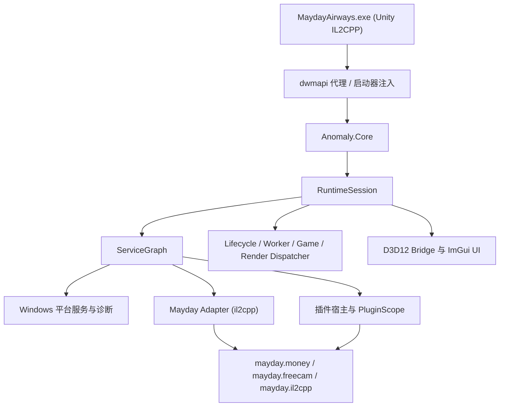

# 架构概览

## 运行时形态

生产组合根是 `src/runtime/core_main.cpp`；`RuntimeSession` 管理进程生命周期，`ServiceGraph`
管理依赖顺序。Bootstrap 只负责把 Core 安全带入进程。插件宿主、Renderer、Mayday Adapter 和
Repository Worker 都是 Runtime 服务声明的并列所有者。

## 模块契约

| 区域 | 负责内容 | 禁止依赖 |
| --- | --- | --- |
| `src/bootstrap/dwmapi` | 系统转发和异步 Core 启动 | 配置、Hook、插件、UI |
| `src/runtime` | Session 状态、ServiceGraph、停止信号、Dispatcher | Unity/Mayday 布局、渲染细节、插件实现 |
| `src/services`、`src/platform/windows`、`src/diagnostics` | 日志、存储、内存、Pattern、Pipe、Crash | Mayday 策略、插件行为 |
| `src/game/mayday` | 等待 `GameAssembly.dll`、解析 il2cpp、发布 Mayday 服务 | 生命周期所有权、插件实现 |
| `src/plugin` | Manifest、依赖、Scope、generation、热重载 | Renderer 后端内部、固定游戏地址 |
| `src/render/dx12`、`src/ui` | SwapChain、输入、ImGui 与插件绘制 | 包 I/O、DLL 加载、同步 Game Update |
| `src/repository` | 签名 Index、网络 worker、staging、回滚 | 游戏对象、渲染提交、插件回调 |
| `include/anomaly/sdk` | 稳定公开 C ABI 与 C++ wrapper | 宿主内部类型 |

## 线程域

| 域 | 允许工作 | 禁止工作 |
| --- | --- | --- |
| Bootstrap | 解析导出，在 Loader Lock 外启动 Runtime | 长循环、插件回调 |
| Lifecycle | 服务/插件状态转换、热重载提交、停止 | 直接读取游戏对象、提交 D3D12 命令 |
| Worker | 解析、哈希、扫描准备、Repository 网络 | 使用仅在 Game/Render 线程有效的指针 |
| Game | 已验证的 il2cpp 服务调用与快照刷新 | 包发现、同步文件 I/O |
| Render | Present/Resize、ImGui、纹理上传、插件 Draw | DLL 加载、il2cpp 扫描、阻塞生命周期工作 |
| Diagnostics | 解析请求、采集只读快照、投递 intent | 直接修改 Game/Render 状态 |

Dispatcher 任务必须携带 owner、generation、取消状态和 in-flight lease。禁止在持有
ServiceGraph、Catalog、Scope 或 HookManager 锁时调用插件代码。

## Mayday 适配

- 宿主等待 `GameAssembly.dll` 加载后解析 il2cpp 导出函数。
- 类、方法和字段按名称在运行时解析并校验；失败时对应服务返回 `UNAVAILABLE`。
- `mayday.money` 读写 `Mayday.GameState` 的 Mirror SyncVar；`mayday.freecam` 在主线程接管相机。
- 覆盖层展开时阻断 InputSystem 按钮、滚轮与 UGUI `EventSystem` 输入。

## 变更规则

- 新增 il2cpp 类、方法或字段：必须在运行时按名称解析并校验，提供不可用/降级行为，不能写死地址、偏移或版本分支。
- 新增 SDK 字段：保持 C 内存布局，使用 `struct_size` 或新的版本化服务表，并同步更新 ABI Snapshot。
- 新增插件资源：登记到 Scope ledger，并在 DLL 卸载前撤销。
- 新增会改变宿主状态的 UI 操作：只能投递 typed work，不能在 `Present` 执行发现、磁盘访问或网络工作。
